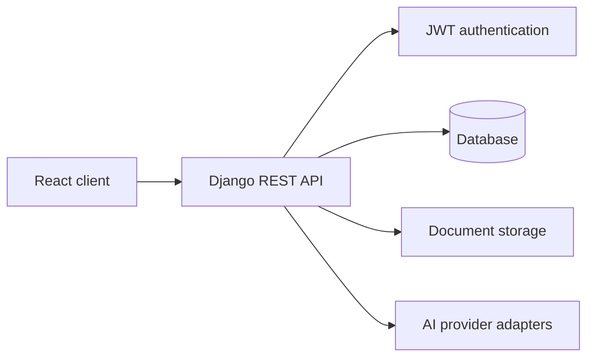

# ManageMyDocument — Backend

Django REST Framework backend for a document-management application with AI-assisted question answering.

## Capabilities

- User registration and JWT-based authentication.
- Document upload, listing, update and deletion.
- Per-user document access and storage workflows.
- AI question-answering integration using external model providers (Gemini and Hugging Face, as configured by the application).

## Architecture



## Technology

Python · Django · Django REST Framework · JWT · PostgreSQL / SQLite · Gemini API · Hugging Face

## Local development

```bash
git clone https://github.com/Sandeep-kumar-IITR/ManageMyDoc.git
cd ManageMyDoc
python -m venv .venv
# Windows: .venv\\Scripts\\activate
# macOS/Linux: source .venv/bin/activate
pip install -r requirements.txt
```

Configure environment variables in a local, untracked `.env` file. At minimum, provide the Django secret key, database configuration and any AI provider credentials required by the code. Never commit real credentials.

Run migrations and start the development server:

```bash
python manage.py migrate
python manage.py runserver
```

## API surface

The original project documentation describes registration, login/logout, document CRUD and an AI question-answering endpoint. Check the URL configuration and serializers for the authoritative request/response schemas before integrating a client.

## Repository hygiene

Before making this repository a public portfolio project, remove local databases, user-uploaded documents, generated files and any credentials from the repository and its Git history. Use synthetic sample data and documented environment-variable names instead.

## Related project

- [ManageMyDocument frontend](https://github.com/Sandeep-kumar-IITR/ManageMyDocument)

## Author

**Sandeep Kumar** · [GitHub](https://github.com/Sandeep-kumar-IITR)
